# ⚡ Awesome CLI Developer Tools

  

  
  
  
  
  
  
  

---

## 🌟 Overview & Ecosystem

> **A curated, comprehensive catalog of enterprise SaaS platforms and leading open-source CLI developer tools.**  
> *Targeted at modern terminal emulators, GPU-accelerated shell environments, cross-platform SSH/SFTP session managers, terminal multiplexers, and high-performance command-line utilities.*

Whether you are configuring a blazingly fast local development workflow, running multi-cloud server administration, or deploying agentic AI terminal workflows, this guide indexes the absolute best command-line utilities and terminal software available today.

---

## 📑 Table of Contents

- [📊 Sector Overview & Market Dynamics](#-sector-overview--market-dynamics)
- [💼 SaaS & Commercial Hosted Platforms](#-saas--commercial-hosted-platforms)
- [🚀 Top Open-Source GitHub Projects](#-top-open-source-github-projects)
  - [🖥️ Modern Terminal Emulators](#️-modern-terminal-emulators)
  - [🪟 Terminal Multiplexers & Session Managers](#-terminal-multiplexers--session-managers)
  - [🐚 Shells & Prompt Engines](#-shells--prompt-engines)
  - [⚡ Blazing-Fast CLI Utilities & Navigators](#-blazing-fast-cli-utilities--navigators)
  - [🛠️ TUI Frameworks & System Monitors](#️-tui-frameworks--system-monitors)
- [📈 Star History](#-star-history)
- [💖 Support & Sponsorship](#-support--sponsorship)
- [🤝 How to Contribute](#-how-to-contribute)
- [⚖️ Disclaimer](#️-disclaimer)

---

## 📊 Sector Overview & Market Dynamics

The global terminal emulator and remote connectivity software market is estimated at **$4.2 billion to $5.5 billion**, expanding at a steady CAGR of ~6.8% alongside rapid enterprise cloud migration and remote IT administration demands. 

The developer tools sector is **highly fragmented and community-driven** rather than a winner-take-all monopoly: while legacy commercial vendors maintain consolidated footholds in compliance-driven corporate environments, modern software engineers and DevOps professionals heavily favor open-source, modular, and GPU-accelerated utilities (Rust/Go), swapping and combining distinct terminal components (multiplexers, fuzzy finders, custom shells) to match personal workflows.

---

## 💼 SaaS & Commercial Hosted Platforms

The table below lists leading commercial SSH clients, remote desktop managers, and enterprise terminal suites. Sorted by company size and market valuation in descending order.

| Product | Description | Valuation / Scale | Starting Price | Free Tier Limits |
| :--- | :--- | :--- | :--- | :--- |
| **[SecureCRT](https://www.vandyke.com/products/securecrt/)** | Enterprise-grade secure remote access, terminal emulation, rock-solid session management, and data tunneling. | **~$100M+ est. valuation** ($25M–$34M annual revenue; mature bootstrapped leader) | **$119.00 / license** (perpetual license with 1-year updates & support) | **30-day fully functional free trial** (unrestricted access to all sessions and automation features during evaluation) |
| **[Termius](https://termius.com/)** | Modern cross-platform SSH, SFTP, and Mosh client featuring encrypted cloud vault sync, snippets, and mobile access. | **~$20M–$35M est. valuation** (~$4M ARR; backed by Seed institutional VC) | **$10.00 / month** (billed annually for Pro individual plan) | **Free Starter Plan forever** (limited to single local device vault; no cross-device cloud sync or automated port forwarding) |
| **[MobaXterm](https://mobaxterm.mobatek.net/)** | All-in-one Windows terminal suite with integrated X11 server, tabbed SSH, SFTP, RDP, VNC, and portable toolsets. | **~$10M–$15M est. valuation** (~$1.5M annual revenue; bootstrapped French ISV) | **$69.00 / user** (perpetual license for Professional Edition with 1-year maintenance) | **Home Edition (Free forever)** (restricted to 14 maximum saved sessions, 2 simultaneous SSH tunnels, and 4 macros) |
| **[Royal TS](https://www.royalapps.com/)** | Cross-platform multi-protocol connection manager supporting RDP, VNC, SSH, SFTP, credentials, and tasks. | **~$5M–$10M est. valuation** (Privately held Austrian ISV; independent niche leader) | **€49.00 (~$53 USD) / license** (perpetual single-user license with 1-year maintenance) | **Shareware Mode (Free forever)** (restricted to maximum 10 connections, 10 saved credentials, and only 1 open document at a time) |

---

## 🚀 Top Open-Source GitHub Projects

All open-source repositories are indexed below and ranked by their **GitHub Stars_Count** (descending). Badges link directly to each repository's stargazers community.

| Project | GitHub_Stars | Language | Primary Category | Highlights |
| :--- | :--- | :--- | :--- | :--- |
| **[Windows Terminal](https://github.com/microsoft/terminal)** |  | C++ | Terminal Emulator | Modern, fast Windows terminal with tabs, panes, Unicode/UTF-8 support, and GPU text rendering. |
| **[fzf](https://github.com/junegunn/fzf)** |  | Go | Interactive Search | Blazingly fast, general-purpose command-line fuzzy finder with zero dependencies. |
| **[lazygit](https://github.com/jesseduffield/lazygit)** |  | Go | Git TUI | Simple, keyboard-driven terminal UI for everyday Git workflows and branch staging. |
| **[Tabby](https://github.com/Eugeny/tabby)** |  | TypeScript | SSH & Terminal | Infinitely customizable cross-platform terminal & SSH client; self-hostable sync alternative to Termius. |
| **[ripgrep](https://github.com/BurntSushi/ripgrep)** |  | Rust | Code Search | Ultrafast line-oriented recursive regex search tool that respects `.gitignore` rules automatically. |
| **[Alacritty](https://github.com/alacritty/alacritty)** |  | Rust | Terminal Emulator | Lightweight, GPU-accelerated terminal emulator focused on extreme rendering performance and simplicity. |
| **[Warp](https://github.com/warpdotdev/warp)** |  | Rust | AI Terminal | Modern agentic development environment and AI-native terminal with block-based commands and workflow sharing. |
| **[Ghostty](https://github.com/ghostty-org/ghostty)** |  | Zig | Terminal Emulator | Fast, feature-rich terminal emulator with native platform UI integration and GPU acceleration. |
| **[bat](https://github.com/sharkdp/bat)** |  | Rust | CLI Utility | Modern `cat` clone with syntax highlighting, Git modifications integration, and automatic paging. |
| **[Starship](https://github.com/starship/starship)** |  | Rust | Prompt Engine | Minimal, ultra-fast, and infinitely customizable cross-shell prompt for any interpreter. |
| **[tmux](https://github.com/tmux/tmux)** |  | C | Multiplexer | The battle-tested terminal multiplexer standard for session detachment, window tiling, and remote persistence. |
| **[GitHub CLI](https://github.com/cli/cli)** |  | Go | Developer Tool | Official GitHub CLI bringing pull requests, issues, releases, and GitHub Actions to your terminal. |
| **[Bubble Tea](https://github.com/charmbracelet/bubbletea)** |  | Go | TUI Framework | The Elm-architecture TUI framework powering modern rich command-line interfaces. |
| **[fd](https://github.com/sharkdp/fd)** |  | Rust | File Search | Simple, fast, and user-friendly alternative to `find` with colored output and smart case sensitivity. |
| **[Hyper](https://github.com/vercel/hyper)** |  | TypeScript | Terminal Emulator | Electron and Web-technology-powered extensible terminal emulator with an extensive npm plugin ecosystem. |
| **[Nushell](https://github.com/nushell/nushell)** |  | Rust | Shell | A modern shell that treats command output as structured tables and data objects rather than raw strings. |
| **[zoxide](https://github.com/ajeetdsouza/zoxide)** |  | Rust | Navigation | Smarter `cd` command that remembers your habits to jump across nested directories in a few keystrokes. |
| **[HTTPie CLI](https://github.com/httpie/cli)** |  | Python | HTTP Client | Human-friendly command-line HTTP client with formatted JSON output, syntax coloring, and persistent sessions. |
| **[Zellij](https://github.com/zellij-org/zellij)** |  | Rust | Multiplexer | Modern terminal workspace and multiplexer featuring built-in layout engines and WebAssembly plugins. |
| **[Kitty](https://github.com/kovidgoyal/kitty)** |  | Python/C | Terminal Emulator | Blazing-fast GPU-rendered terminal emulator supporting ligatures, graphics protocols, and scriptable layouts. |
| **[btop](https://github.com/aristocratos/btop)** |  | C++ | Resource Monitor | Aesthetic and responsive terminal monitor for CPU, memory, disks, network, and process management. |
| **[fish shell](https://github.com/fish-shell/fish-shell)** |  | Rust | Shell | Smart and user-friendly interactive shell with autosuggestions, syntax highlighting, and zero setup. |
| **[delta](https://github.com/dandavison/delta)** |  | Rust | Git Pager | Beautiful syntax-highlighting pager for Git, diff, and grep outputs with side-by-side view capabilities. |
| **[Atuin](https://github.com/atuinsh/atuin)** |  | Rust | Shell History | Replaces standard shell history with an encrypted SQLite database and optional end-to-end sync. |
| **[WezTerm](https://github.com/wez/wezterm)** |  | Rust | Terminal Emulator | GPU-accelerated cross-platform terminal and multiplexer configured entirely via expressive Lua scripts. |
| **[eza](https://github.com/eza-community/eza)** |  | Rust | CLI Utility | Modern, maintained replacement for `ls` featuring file icons, Git status indicators, and tree views. |
| **[iTerm2](https://github.com/gnachman/iTerm2)** |  | Objective-C | Terminal Emulator | The gold standard macOS terminal emulator featuring split panes, triggers, inline images, and shell integration. |
| **[navi](https://github.com/denisidoro/navi)** |  | Rust | Cheatsheet | Interactive CLI cheatsheet tool that prompts for arguments before running complex terminal commands. |
| **[sd](https://github.com/chmln/sd)** |  | Rust | CLI Utility | Intuitive find & replace command-line tool designed as a user-friendly, regex-aware alternative to `sed`. |
| **[gdu](https://github.com/dundee/gdu)** |  | Go | Disk Analyzer | Fast disk usage analyzer with an interactive console interface designed especially for SSD drives. |

---

### 🖥️ Modern Terminal Emulators
- **[Windows Terminal](https://github.com/microsoft/terminal)** — The standard for Windows, supporting tabs, panes, and GPU rendering.
- **[Alacritty](https://github.com/alacritty/alacritty)** — The lightweight Rust-based champion of raw performance and minimalist footprint.
- **[Warp](https://github.com/warpdotdev/warp)** — The AI-native terminal reinventing CLI collaboration and agentic prompt assistance.
- **[Ghostty](https://github.com/ghostty-org/ghostty)** — High-performance native UI terminal with GPU acceleration crafted by Mitchell Hashimoto.
- **[Tabby](https://github.com/Eugeny/tabby)** — Multi-protocol terminal and connection manager with integrated SFTP and serial support.
- **[Kitty](https://github.com/kovidgoyal/kitty)** — GPU-accelerated power-tool with rich image protocol, tabs, and tiling.
- **[WezTerm](https://github.com/wez/wezterm)** — Highly programmable terminal emulator with embedded Lua configuration and multiplexing.
- **[iTerm2](https://github.com/gnachman/iTerm2)** — Comprehensive and battle-tested terminal designed specifically for macOS power users.
- **[Hyper](https://github.com/vercel/hyper)** — Clean, extensible terminal constructed on Electron, React, and web technologies.

### 🪟 Terminal Multiplexers & Session Managers
- **[tmux](https://github.com/tmux/tmux)** — The ubiquitous terminal multiplexer for long-running sessions, windows, and detachability.
- **[Zellij](https://github.com/zellij-org/zellij)** — Modern Rust-powered workspace with intuitive UI ribbons, tabs, and WebAssembly plugin extensions.

### 🐚 Shells & Prompt Engines
- **[Starship](https://github.com/starship/starship)** — Universal, fast prompt engine showing Git branches, language versions, and system stats.
- **[Nushell](https://github.com/nushell/nushell)** — Data-first shell transforming pipelines into queryable structured tables.
- **[fish shell](https://github.com/fish-shell/fish-shell)** — Intuitive command-line shell with syntax highlighting and autosuggestions out of the box.
- **[Atuin](https://github.com/atuinsh/atuin)** — Magically enhances shell history with search filters, SQLite persistence, and sync.

### ⚡ Blazing-Fast CLI Utilities & Navigators
- **[fzf](https://github.com/junegunn/fzf)** — General-purpose command-line fuzzy finder for commands, files, and Git branches.
- **[ripgrep](https://github.com/BurntSushi/ripgrep)** — Ultra-fast regex file searcher outperforming grep and ack.
- **[bat](https://github.com/sharkdp/bat)** — Feature-rich replacement for `cat` with automatic syntax highlighting and Git diff tags.
- **[fd](https://github.com/sharkdp/fd)** — User-friendly and faster alternative to `find`.
- **[zoxide](https://github.com/ajeetdsouza/zoxide)** — Fast directory jumping based on frequency and recency.
- **[eza](https://github.com/eza-community/eza)** — Feature-packed modern replacement for `ls`.
- **[delta](https://github.com/dandavison/delta)** — Side-by-side terminal syntax-highlighting pager for Git.
- **[sd](https://github.com/chmln/sd)** — Intuitive search and replace utility replacing sed commands.
- **[navi](https://github.com/denisidoro/navi)** — Interactive cheatsheet tool providing quick access to complex commands.
- **[HTTPie CLI](https://github.com/httpie/cli)** — Modern API client designed for interactive HTTP exploration.
- **[GitHub CLI](https://github.com/cli/cli)** — Manage GitHub pull requests, issues, and repositories right in your terminal.

### 🛠️ TUI Frameworks & System Monitors
- **[Bubble Tea](https://github.com/charmbracelet/bubbletea)** — The premier framework for writing interactive terminal user interfaces in Go.
- **[btop](https://github.com/aristocratos/btop)** — Beautiful resource monitor with interactive graphs for CPU, memory, and disks.
- **[lazygit](https://github.com/jesseduffield/lazygit)** — Effortlessly manage Git branches, commits, stashes, and rebases via keyboard.
- **[gdu](https://github.com/dundee/gdu)** — Console disk usage scanner built for rapid SSD indexation.

---

## 📈 Star History

---

## 💖 Support & Sponsorship

If you find **Awesome CLI Developer Tools** useful or time-saving for your daily terminal setup:

- ⭐ **Star this repository** to help other developers discover modern CLI tools.
- 🍴 **Fork and contribute** your favorite utilities, terminal themes, or configurations.
- 📣 **Share this list** with your colleagues, DevOps teams, and developer communities.
- ☕ **Buy a coffee & sponsor ongoing curation**: Support this project directly on the [GitHub Sponsor Dashboard](https://github.com/sponsors/ishandutta2007).

---

## 🤝 How to Contribute

Contributions are welcome and actively encouraged! To submit a new tool:

1. **Fork** this repository.
2. Ensure the tool is active, well-maintained, and adds distinct value to CLI developers.
3. Add your entry in alphabetical or appropriate category order matching the table format.
4. Include official links, primary language, and exact pricing/license specifications.
5. Open a **Pull Request** with a concise description of why the tool should be added.

---

## ⚖️ Disclaimer

- This list is independently curated by the community for informational and educational purposes; no direct endorsement is implied.
- Always review credential handling, telemetry policies, and key storage practices when deploying terminal clients and remote SSH management suites.
